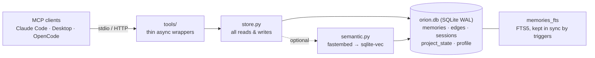

<p align="center">
  
</p>

<p align="center">
  
  
  
  
  
  
  
</p>

---

MCP server that gives AI coding assistants **long-term, per-project memory**:
decisions, hybrid search, a knowledge graph, session history and a developer profile.
Works with Claude Code, Claude Desktop, OpenCode and any MCP client.

|  Memory |  Search |  Graph |  Sessions |  Profile |
|:---:|:---:|:---:|:---:|:---:|
| Decisions per project | Keywords (BM25) + optional semantic | Typed relationships | Phase, next steps, history | Free-form sections |

## Quick start

```bash
git clone https://github.com/jdvalmart/orion && cd orion
uv venv && uv pip install -e '.[semantic]'   # drop [semantic] for keyword-only search

.venv/bin/orion                                          # stdio (default)
ORION_TOKEN=change-me .venv/bin/orion --transport http   # HTTP on 127.0.0.1:9099
```

## Connect

Every stdio client runs the same command: the absolute path to `.venv/bin/orion`.
Several clients can run at once — SQLite serialises their writes.

<details open>
<summary>Claude Code</summary>

```bash
claude mcp add orion --scope user -- /path/to/orion/.venv/bin/orion
```
</details>

<details>
<summary>Claude Desktop — <code>claude_desktop_config.json</code></summary>

```json
{
  "mcpServers": {
    "orion": { "command": "/path/to/orion/.venv/bin/orion" }
  }
}
```
</details>

<details>
<summary>OpenCode — <code>opencode.json</code></summary>

```jsonc
{
  "mcp": {
    "orion": { "type": "local", "command": ["/path/to/orion/.venv/bin/orion"] }
  }
}
```
</details>

## Projects

Every memory and session belongs to a project, resolved in this order:

1. the `project` argument of the tool call;
2. `ORION_PROJECT` in the server environment;
3. the first MCP root the client advertises (its workspace folder);
4. the git repository containing the server's working directory;
5. `general`.

Search and listing tools take `scope="all"` to work across projects.

## Tools

| Tool | Group | Description |
|------|-------|-------------|
| `remember_decision` | Memory | Store a decision (optionally `supersedes` an older one) |
| `recall_context` | Search | Hybrid keyword + semantic search, ranked with RRF |
| `revise_decision` | Memory | Update fields of a decision, or move it to another project |
| `forget_decision` | Memory | Delete a decision and its graph relationships |
| `browse_memories` | Memory | Paged listing, filterable by tag |
| `link_concepts` | Graph | `depends_on`, `relates_to`, `alternative_to`, `supersedes` |
| `find_related` | Graph | Neighbours of a decision, both directions |
| `browse_graph` | Graph | Paged listing of relationships |
| `remember_session` | Sessions | Save a session summary, next steps and phase |
| `recall_session` | Sessions | Resume a project: phase, next steps, recent work |
| `browse_sessions` | Sessions | Paged session history |
| `list_projects` | Sessions | Known projects with counts |
| `whoami` | Profile | The developer profile |
| `update_profile` | Profile | Replace or remove one profile section |
| `orion_health` | Admin | Version, paths, counts, integrity, search status |
| `backup_to_s3` / `restore_from_s3` | Admin | Only when `ORION_S3_BUCKET` is set (`.[s3]` extra) |

Also exposed: the prompt `start_session(project)` and the resource
`orion://project/{name}/context`.

All tools return structured output (JSON with an output schema).

## Configuration

| Variable | Default | Purpose |
|----------|---------|---------|
| `ORION_DATA_DIR` | `~/.local/share/orion` | Database, logs, models, local backups |
| `ORION_PROJECT` | — | Pin this server instance to one project |
| `ORION_SEMANTIC` | `auto` | `off` disables embeddings |
| `ORION_EMBED_MODEL` | `paraphrase-multilingual-MiniLM-L12-v2` | fastembed model (Spanish + English) |
| `ORION_TOKEN` | — | Bearer token for HTTP; required to bind a non-loopback host |
| `ORION_S3_BUCKET` / `ORION_S3_PREFIX` | — / `orion-backup` | Enable S3 backup tools |
| `ORION_LOG_LEVEL` | `INFO` | Logging level (stderr + `logs/orion.log`) |

## Architecture



- **One file, one source of truth.** Writes use `BEGIN IMMEDIATE`, so concurrent clients never
  lose updates, and ids (`AUTOINCREMENT`) are never reused.
- **Vectors are derived data.** Any memory missing a vector is re-embedded on the next search.
- **Soft deletes.** Forgotten decisions keep their id; their relationships are removed.

## Migrating from the JSON store (v4)

```bash
python scripts/clean_test_data.py --source data          # writes data/quarantine.json to review
python scripts/migrate_json_to_sqlite.py --source data --dry-run
python scripts/migrate_json_to_sqlite.py --source data   # idempotent
```

## Quality

```bash
uv pip install -e '.[semantic,s3,dev]'
ruff check src tests scripts && ruff format --check src tests scripts
mypy
pytest -q    # semantic tests run only when the model is already downloaded
```

## Structure

```
orion/
├── src/orion/
│   ├── server.py      # CLI entrypoint `orion`
│   ├── app.py         # FastMCP instance + instructions
│   ├── config.py      # ORION_* settings, logging
│   ├── db.py          # connections, transactions, migrations
│   ├── store.py       # data access
│   ├── semantic.py    # optional embeddings
│   ├── projects.py    # project resolution
│   ├── models.py      # structured outputs
│   └── tools/         # memory · graph · session · profile · admin · backup
├── scripts/           # legacy cleanup + migration
├── tests/
└── docs/
```

---

<p align="center">
  <sub>Part of <a href="https://github.com/jdvalmart">universo</a> — Orion · Vela · Draco · Lyra · Ara</sub>
</p>
